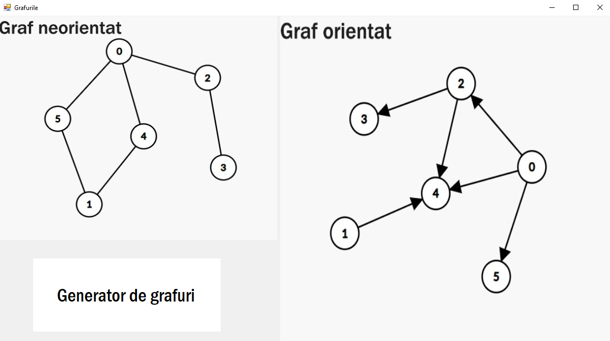
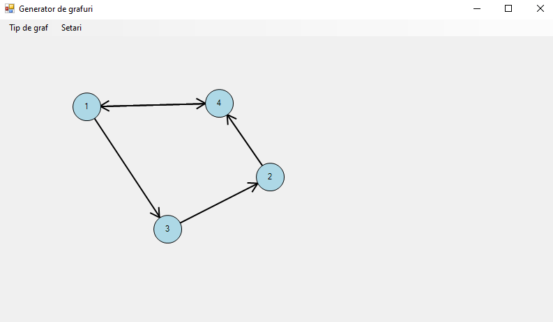
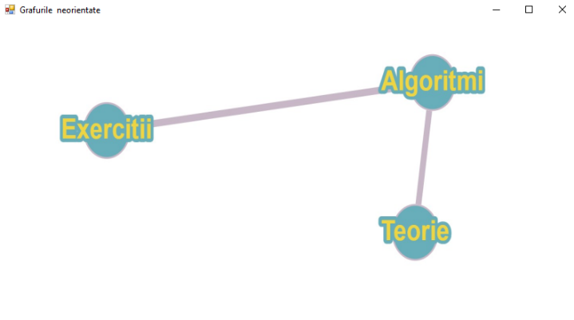
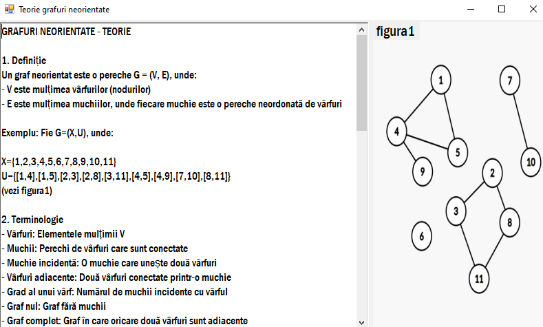
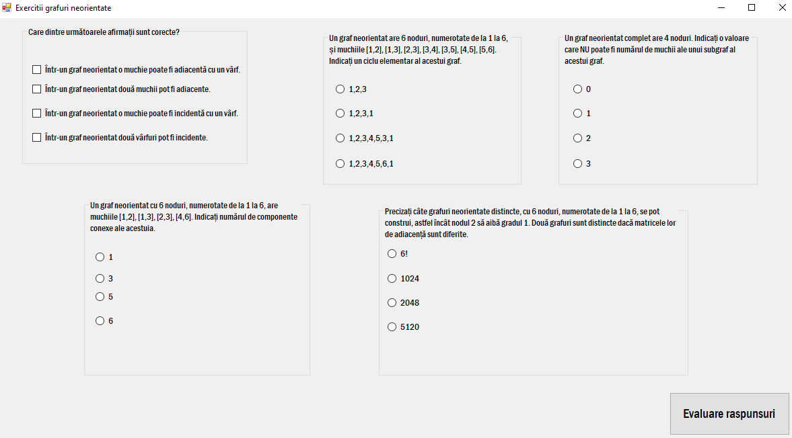

# Graph Explorer

An interactive **C# Windows Forms** application for learning about graphs. It combines a visual **graph editor** with theory pages and self-check quizzes on directed and undirected graphs.

I built it as my high-school graduation project (*proiect de atestat*) in the 12th grade, in 2025. The UI text is in Romanian.

## Features

### Graph editor

Draw graphs directly with the mouse:

- **Add nodes** by clicking anywhere on the canvas
- **Add edges** by selecting two nodes. While you choose the second node, a dashed preview line follows the cursor.
- **Switch between undirected and directed graphs**. Directed edges are drawn with arrowheads.
- **Drag nodes** to rearrange the graph
- **Right-click** a node to delete it together with its edges, or right-click near an edge to delete only that edge
- **Clear** the whole graph from the menu

### Learning sections

For both **undirected** and **directed** graphs there is a section with three parts:

- **Theory**: definitions, terminology and illustrated examples
- **Algorithms**: overviews of BFS, DFS, Dijkstra, Floyd–Warshall, Kruskal, Prim and topological sorting, with their complexity and applications
- **Exercises**: a 5-question quiz with automatic scoring

| Section menu | Theory | Quiz |
|---|---|---|
|  |  |  |

## How it works

- The graph is stored as two lists, `List<GraphNode>` and `List<GraphEdge>`. Each node keeps its id, position, label, color and radius. Each edge keeps its endpoints, weight, color and whether it is directed.
- The editor overrides `OnMouseDown`, `OnMouseMove`, `OnMouseUp` and `OnPaint` and draws everything with GDI+ (`System.Drawing`).
- Arrowheads are computed from the angle between the two nodes.
- A small hit-testing method (`IsPointOnEdge`) measures the distance from the cursor to an edge, so edges can be deleted without pixel-perfect clicks.
- Images on the main menu get a hover effect (a 3D border and a shadow panel). The shadow panel is created on mouse enter and disposed on mouse leave.

Most of the hand-written logic is in [`atestat/Form4.cs`](atestat/Form4.cs), the graph editor.

## Tech stack

- C# and Windows Forms
- .NET Framework 4.7.2
- Visual Studio

## Building and running

1. Install **Visual Studio 2022 or newer** with the **.NET desktop development** workload.
2. Clone the repository and open `atestat.sln`.
3. Press **F5**.

If Visual Studio says the .NET Framework 4.7.2 targeting pack is missing, either install it or accept the suggestion to retarget the project to .NET Framework 4.8.

## Documentation

The full project documentation, in Romanian, is in [`docs/`](docs/).

## Possible improvements

- Run BFS and DFS step by step on the graph you drew, with a visual animation
- Show the adjacency and incidence matrices of the current graph
- Save and load graphs from files, and export them as images
- Check graph properties automatically, such as connectivity, paths and cycles

## Credits

The theory and exercise content is based on materials from [pbinfo.ro](https://www.pbinfo.ro).
